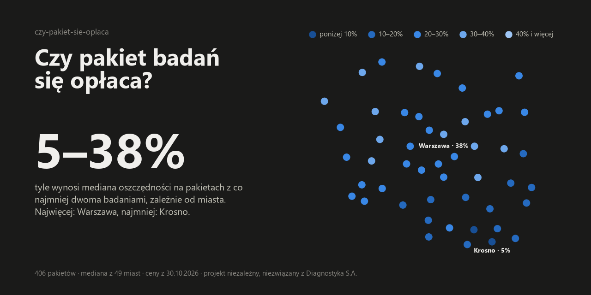
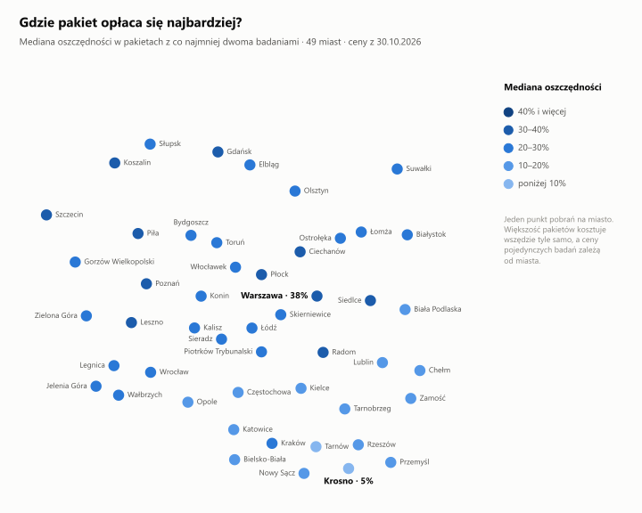
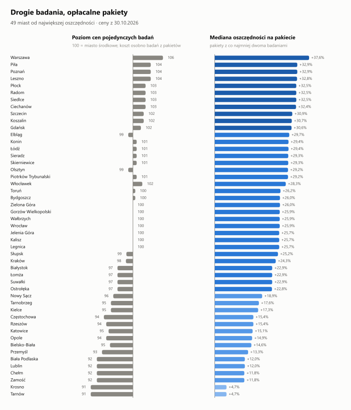
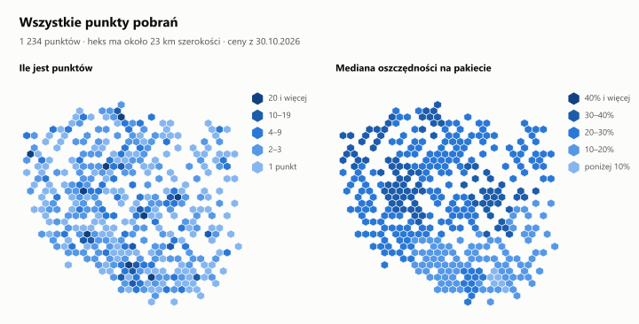
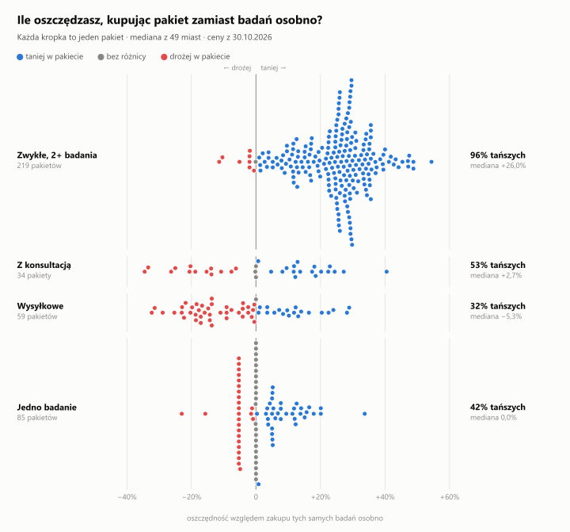
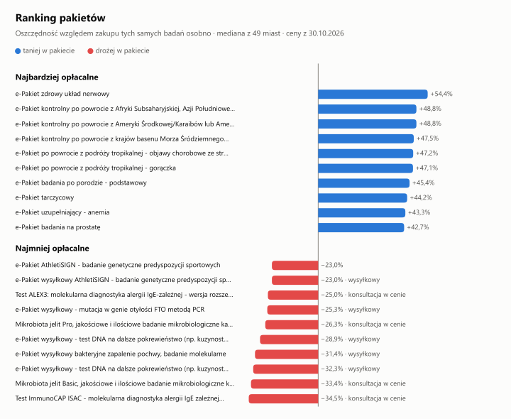
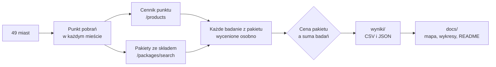

<p align="center">
  
</p>

<h1 align="center">Czy pakiet się opłaca?</h1>

<p align="center">
  <b>Porównanie cen pakietów badań Diagnostyki z ceną tych samych badań kupionych osobno, w 49 miastach.</b><br>
  Python · publiczne API e-sklepu · wyniki w CSV/JSON i na wykresach.
</p>

<p align="center">
  Autor: <b>Aleksander Kutycki</b> · <a href="https://github.com/olekkut">GitHub</a> · <a href="https://www.linkedin.com/in/kutycki/">LinkedIn</a> · <a href="LICENSE">Apache-2.0</a>
</p>

---

Diagnostyka sprzedaje kilkaset pakietów badań: tarczycowy, dla kobiet, po powrocie z tropików. Czy taki pakiet jest tańszy niż te same badania zamówione pojedynczo? Skrypty pobierają cennik punktu pobrań, rozkładają każdy pakiet na badania i liczą, ile naprawdę oszczędzasz albo dopłacasz. Robią to dla 49 miast, bo ceny pojedynczych badań zależą od miasta.

> **In English:** a small Python tool that checks whether lab-test bundles sold by Diagnostyka, Poland's largest lab chain, are cheaper than buying the same tests one by one. It reads the shop's public API, prices every bundle's components in 49 Polish cities and charts the result.

## Wyniki

<!-- wyniki:start -->
Stan na **30.10.2026**: 49 miast i 406 pakietów.

**To, ile oszczędzasz, zależy od miasta.** Mediana oszczędności na pakietach z co najmniej dwoma badaniami wynosi od **+4,7%** (Krosno) do **+37,6%** (Warszawa). 379 z 406 pakietów kosztuje we wszystkich miastach tyle samo, a ceny pojedynczych badań zależą od miasta.

<details>
<summary>Tabela: 49 miast od największej oszczędności</summary>

| Miasto | Punkt pobrań | Poziom cen badań | Tańsze pakiety z 2+ badaniami | Mediana oszczędności |
| :--- | :--- | ---: | ---: | ---: |
| Warszawa | Warszawa, al. Dwudziestolatków 3 | 106 | 226 z 238 (95%) | +37,6% |
| Piła | Piła, ul. Podchorążych 1 | 104 | 207 z 221 (94%) | +32,9% |
| Poznań | Poznań, al. Solidarności 36 | 104 | 207 z 221 (94%) | +32,9% |
| Leszno | Leszno, al. 21 Października 23 | 104 | 206 z 220 (94%) | +32,8% |
| Płock | Płock, ul. Armii Krajowej 3b | 103 | 207 z 220 (94%) | +32,5% |
| Radom | Radom, ul. Chrobrego 30c | 103 | 225 z 238 (94%) | +32,5% |
| Siedlce | Siedlce, ul. Kochanowskiego 8 | 103 | 207 z 220 (94%) | +32,5% |
| Ciechanów | Ciechanów, ul. Strażacka 7 | 103 | 206 z 219 (94%) | +32,4% |
| Szczecin | Szczecin, ul. Unii Lubelskiej 1 | 102 | 224 z 237 (94%) | +30,9% |
| Koszalin | Koszalin, ul. Jana Pawła II 7 | 102 | 205 z 218 (94%) | +30,7% |
| Gdańsk | Gdańsk, ul. Kołobrzeska 63f | 102 | 208 z 221 (94%) | +30,6% |
| Elbląg | Elbląg, ul. Gdyńska 51 | 99 | 205 z 219 (94%) | +29,7% |
| Konin | Konin, ul. Wojska Polskiego 33b | 101 | 225 z 238 (94%) | +29,4% |
| Łódź | Łódź, ul. Pługowa 51/53 | 101 | 207 z 220 (94%) | +29,4% |
| Sieradz | Sieradz, ul. Bohaterów Września 61 | 101 | 208 z 221 (94%) | +29,3% |
| Skierniewice | Skierniewice, ul. Gałeckiego 1b | 101 | 208 z 221 (94%) | +29,3% |
| Olsztyn | Olsztyn, ul. Kopernika 30 | 99 | 205 z 219 (94%) | +29,2% |
| Piotrków Trybunalski | Piotrków Trybunalski, ul. Armii Krajowej 15 | 101 | 207 z 220 (94%) | +29,2% |
| Włocławek | Włocławek, ul. Al. Fryderyka Chopina 45/2 | 102 | 206 z 220 (94%) | +28,3% |
| Toruń | Toruń, pl. 18 Stycznia 4 | 100 | 224 z 238 (94%) | +26,2% |
| Bydgoszcz | Bydgoszcz, ul. Gen. A. E. Fieldorfa Nila 4a | 100 | 206 z 220 (94%) | +26,0% |
| Zielona Góra | Zielona Góra, ul. Kupiecka 22 | 100 | 202 z 220 (92%) | +26,0% |
| Gorzów Wielkopolski | Gorzów Wielkopolski, ul. Warszawska 6/208 | 100 | 202 z 220 (92%) | +25,9% |
| Wałbrzych | Wałbrzych, ul. Matejki 5a | 100 | 202 z 220 (92%) | +25,9% |
| Wrocław | Wrocław, ul. Młodych Techników 7 | 100 | 202 z 220 (92%) | +25,9% |
| Jelenia Góra | Jelenia Góra, ul. Bankowa 5/7 | 100 | 220 z 238 (92%) | +25,7% |
| Kalisz | Kalisz, ul. Polna 29 | 100 | 226 z 244 (93%) | +25,7% |
| Legnica | Legnica, ul. Biegunowa 2 | 100 | 220 z 238 (92%) | +25,7% |
| Słupsk | Słupsk, ul. Jana Pawła II 1a | 99 | 225 z 239 (94%) | +25,2% |
| Kraków | Kraków, ul. Olszańska 5 | 98 | 210 z 225 (93%) | +24,3% |
| Białystok | Białystok, ul. Antoniukowska 11 | 97 | 225 z 243 (93%) | +22,9% |
| Łomża | Łomża, al. Marszałka Józefa Piłsudskiego 6 | 97 | 203 z 219 (93%) | +22,9% |
| Suwałki | Suwałki, ul. Utrata 4c | 97 | 223 z 241 (92%) | +22,9% |
| Ostrołęka | Ostrołęka, ul. 11 Listopada 27 | 97 | 208 z 225 (92%) | +22,8% |
| Nowy Sącz | Nowy Sącz, ul. Żółkiewskiego 11 | 96 | 198 z 220 (90%) | +18,9% |
| Tarnobrzeg | Tarnobrzeg, ul. Wyspiańskiego 13 | 95 | 217 z 238 (91%) | +17,6% |
| Kielce | Kielce, ul. Warszawska 151 | 95 | 199 z 219 (91%) | +17,3% |
| Częstochowa | Częstochowa, al. Wolności 46 | 94 | 197 z 219 (90%) | +15,4% |
| Rzeszów | Rzeszów, ul. Krzyżanowskiego 6h | 94 | 195 z 220 (89%) | +15,4% |
| Katowice | Katowice, ul. Tysiąclecia 90 | 95 | 195 z 220 (89%) | +15,1% |
| Opole | Opole, ul. Tuwima 1 | 94 | 215 z 239 (90%) | +14,9% |
| Bielsko-Biała | Bielsko-Biała, ul. Żywiecka 71 | 95 | 211 z 237 (89%) | +14,6% |
| Przemyśl | Przemyśl, ul. Jagiellońska 15 | 93 | 215 z 242 (89%) | +13,3% |
| Biała Podlaska | Biała Podlaska, ul. Janowska 76 | 92 | 208 z 234 (89%) | +12,0% |
| Lublin | Lublin, ul. Topolowa 7 | 92 | 196 z 221 (89%) | +12,0% |
| Chełm | Chełm, al. 3 Maja 22/3 | 92 | 190 z 215 (88%) | +11,8% |
| Zamość | Zamość, al. Jana Pawła II 19 | 92 | 190 z 215 (88%) | +11,8% |
| Krosno | Krosno, ul. Grodzka 47 | 91 | 132 z 193 (68%) | +4,7% |
| Tarnów | Tarnów, ul. Lwowska 197 | 91 | 132 z 193 (68%) | +4,7% |

</details>

W skali kraju, czyli dla mediany z miast, **93% pakietów z co najmniej dwoma badaniami jest tańszych** niż te same badania kupione osobno.

| Typ pakietu | Pakietów | Taniej w pakiecie | Bez różnicy | Drożej w pakiecie | Mediana oszczędności |
| :--- | ---: | ---: | ---: | ---: | ---: |
| Zwykłe, 2+ badania | 219 | 210 (96%) | 1 | 8 | +26,0% |
| Z konsultacją | 34 | 18 (53%) | 3 | 13 | +2,7% |
| Wysyłkowe | 59 | 19 (32%) | 1 | 39 | −5,3% |
| Jedno badanie | 85 | 36 (42%) | 23 | 26 | 0,0% |

<details>
<summary>Tabela: 10 najbardziej i 10 najmniej opłacalnych pakietów</summary>

**Najbardziej opłacalne**

| Pakiet | Cena pakietu | Badania osobno | Oszczędność | Opłaca się w |
| :--- | ---: | ---: | ---: | ---: |
| [e-Pakiet zdrowy układ nerwowy](https://diag.pl/sklep/pakiety/e-pakiet-zdrowy-uklad-nerwowy) | 609,00 zł | 1 335,70 zł | +726,70 zł (+54,4%) | 47 z 47 miast |
| [e-Pakiet kontrolny po powrocie z Afryki Subsaharyjskiej, Azji Południowej lub Azji Południowo-Wschodniej](https://diag.pl/sklep/pakiety/e-pakiet-kontrolny-po-powrocie-z-afryki-subsaharyjskiej-azji-poludniowej-lub-azji-poludniowo-wschodniej) | 1 086,00 zł | 2 119,45 zł | +1 033,45 zł (+48,8%) | 43 z 43 miast |
| [e-Pakiet kontrolny po powrocie z Ameryki Środkowej/Karaibów lub Ameryki Południowej](https://diag.pl/sklep/pakiety/e-pakiet-kontrolny-po-powrocie-z-ameryki-srodkowejkaraibow-lub-ameryki-poludniowej) | 1 086,00 zł | 2 119,45 zł | +1 033,45 zł (+48,8%) | 43 z 43 miast |
| [e-Pakiet kontrolny po powrocie z krajów basenu Morza Śródziemnego (Europa, Afryka Północna)](https://diag.pl/sklep/pakiety/e-pakiet-kontrolny-po-powrocie-z-krajow-basenu-morza-srodziemnego-europa-afryka-polnocna) | 867,00 zł | 1 653,00 zł | +786,00 zł (+47,5%) | 43 z 43 miast |
| [e-Pakiet po powrocie z podróży tropikalnej - objawy chorobowe ze strony układu pokarmowego](https://diag.pl/sklep/pakiety/e-pakiet-po-powrocie-z-podrozy-tropikalnej-objawy-chorobowe-ze-strony-ukladu-pokarmowego) | 328,00 zł | 621,78 zł | +293,78 zł (+47,2%) | 45 z 45 miast |
| [e-Pakiet po powrocie z podróży tropikalnej - gorączka](https://diag.pl/sklep/pakiety/e-pakiet-po-powrocie-z-podrozy-tropikalnej-goraczka) | 1 086,00 zł | 2 051,05 zł | +965,05 zł (+47,1%) | 43 z 43 miast |
| [e-Pakiet badania po porodzie - podstawowy](https://diag.pl/sklep/pakiety/e-pakiet-dla-kobiet-po-porodzie) | 139,00 zł | 254,60 zł | +115,60 zł (+45,4%) | 49 z 49 miast |
| [e-Pakiet tarczycowy](https://diag.pl/sklep/pakiety/e-pakiet-tarczycowy) | 80,00 zł | 143,45 zł | +63,45 zł (+44,2%) | 49 z 49 miast |
| [e-Pakiet uzupełniający - anemia](https://diag.pl/sklep/pakiety/e-pakiet-uzupelniajacy-anemia-2) | 119,00 zł | 209,95 zł | +90,95 zł (+43,3%) | 49 z 49 miast |
| [e-Pakiet badania na prostatę](https://diag.pl/sklep/pakiety/e-pakiet-badania-na-prostate) | 89,00 zł | 155,33 zł | +66,33 zł (+42,7%) | 49 z 49 miast |

**Najmniej opłacalne**

| Pakiet | Cena pakietu | Badania osobno | Oszczędność | Opłaca się w |
| :--- | ---: | ---: | ---: | ---: |
| [e-Pakiet AthletiSIGN - badanie genetyczne predyspozycji sportowych](https://diag.pl/sklep/pakiety/e-pakiet-athletisign-profilowanie-genetyczne-dla-sportowcow) | 2 199,00 zł | 1 787,55 zł | −411,45 zł (−23,0%) | 2 z 49 miast |
| [e-Pakiet wysyłkowy AthletiSIGN - badanie genetyczne predyspozycji sportowych](https://diag.pl/sklep/pakiety/e-pakiet-wysylkowy-athletisign-profilowanie-genetyczne-dla-sportowcow) | 2 199,00 zł | 1 787,55 zł | −411,45 zł (−23,0%) | 2 z 49 miast |
| [Test ALEX3: molekularna diagnostyka alergii IgE-zależnej - wersja rozszerzona z konsultacją lekarza alergologa](https://diag.pl/sklep/pakiety/test-alex3-molekularna-diagnostyka-alergii-ige-zaleznej-wersja-rozszerzona-z-konsultacja-lekarza-alergologa) | 2 184,00 zł | 1 747,05 zł | −436,95 zł (−25,0%) | 0 z 49 miast |
| [e-Pakiet wysyłkowy - mutacja w genie otyłości FTO metodą PCR](https://diag.pl/sklep/pakiety/e-pakiet-wysylkowy-mutacja-w-genie-otylosci-fto-metoda-pcr) | 248,00 zł | 198,00 zł | −50,00 zł (−25,3%) | 0 z 49 miast |
| [Mikrobiota jelit Pro, jakościowe i ilościowe badanie mikrobiologiczne kału (38 gatunki bakterii i grzybów) z konsultacją](https://diag.pl/sklep/pakiety/mikrobiota-jelit-pro-jakosciowe-i-ilosciowe-badanie-mikrobiologiczne-kalu-38-gatunki-bakterii-i-grzybow-z-konsultacja) | 959,00 zł | 759,05 zł | −199,95 zł (−26,3%) | 0 z 49 miast |
| [e-Pakiet wysyłkowy - test DNA na dalsze pokrewieństwo (np. kuzynostwo, stryjostwo, wujostwo), do 72 markerów genetycznych, 3 osoby, wymaz lub mikroślad](https://diag.pl/sklep/pakiety/badanie-dalszego-pokrewienstwa-72-markery-genetyczne-3-osoby-3-x-wymaz-ilub-mikroslad) | 5 186,00 zł | 4 024,38 zł | −1 161,62 zł (−28,9%) | 0 z 47 miast |
| [e-Pakiet wysyłkowy bakteryjne zapalenie pochwy, badanie molekularne](https://diag.pl/sklep/pakiety/e-pakiet-wysylkowy-bakteryjne-zapalenie-pochwy-badanie-molekularne) | 209,00 zł | 159,00 zł | −50,00 zł (−31,4%) | 0 z 49 miast |
| [e-Pakiet wysyłkowy - test DNA na dalsze pokrewieństwo (np. kuzynostwo, stryjostwo, wujostwo), do 72 markerów genetycznych, 2 osoby, wymaz lub mikroślad](https://diag.pl/sklep/pakiety/test-na-ojcostwo-i-dalsze-pokrewienstwo-72-markery-genetyczne-2-osoby-2x-wymaz-ilub-mikroslad) | 3 472,00 zł | 2 624,85 zł | −847,15 zł (−32,3%) | 0 z 37 miast |
| [Mikrobiota jelit Basic, jakościowe i ilościowe badanie mikrobiologiczne kału (35 gatunków bakterii i grzybów) z konsultacją](https://diag.pl/sklep/pakiety/mikrobiota-jelit-basic-jakosciowe-i-ilosciowe-badanie-mikrobiologiczne-kalu-35-gatunkow-bakterii-i-grzybow-z-konsultacja) | 759,00 zł | 569,05 zł | −189,95 zł (−33,4%) | 0 z 49 miast |
| [Test ImmunoCAP ISAC - molekularna diagnostyka alergii IgE zależnej - 112 molekuł z konsultacją lekarza alergologa](https://diag.pl/sklep/pakiety/test-immunocap-isac-molekularna-diagnostyka-alergii-ige-zaleznej-112-molekul-z-konsultacja-lekarza-alergologa) | 1 075,00 zł | 799,00 zł | −276,00 zł (−34,5%) | 0 z 47 miast |

</details>
<!-- wyniki:end -->

<picture>
  <source media="(prefers-color-scheme: dark)" srcset="docs/mapa-dark.svg">
  
</picture>

Większość pakietów kosztuje tyle samo w całym kraju, a pojedyncze badania nie. W miastach, w których badania kupowane osobno są drogie, pakiet daje dużą oszczędność. W miastach z tańszymi badaniami ta sama cena pakietu wypada słabiej.

<picture>
  <source media="(prefers-color-scheme: dark)" srcset="docs/miasta-dark.svg">
  
</picture>

<picture>
  <source media="(prefers-color-scheme: dark)" srcset="docs/punkty-dark.svg">
  
</picture>

Każdy punkt pobrań korzysta z jednego z regionalnych cenników. `wszystkie_punkty.py` sprawdza cennik każdego z około 1 250 punktów, więc mapa pokazuje cały kraj, a nie tylko 49 miast.

<picture>
  <source media="(prefers-color-scheme: dark)" srcset="docs/oszczednosci-dark.svg">
  
</picture>

Jak czytać typy pakietów:

- **Zwykłe, 2+ badania**: pakiet to same badania, więc porównanie jest najczystsze.
- **Z konsultacją**: w cenie jest konsultacja lekarza albo dietetyka. Skrypt jej nie wycenia, więc taki pakiet może wyjść drożej niż same badania i nadal mieć sens.
- **Wysyłkowe**: w cenie jest zestaw do pobrania próbki w domu i wysyłka.
- **Jedno badanie**: sklep online sprzedaje pojedyncze badania o 5% taniej niż punkt pobrań, a pakiet jednobadaniowy zwykle kosztuje tyle co badanie w punkcie. Stąd kolumny kropek: przy −5,3% to samo badanie kupisz taniej online, a przy 0 badania nie ma w sklepie online, więc w punkcie zapłacisz tyle samo co za pakiet.

<picture>
  <source media="(prefers-color-scheme: dark)" srcset="docs/ranking-dark.svg">
  
</picture>

## Pobierz dane

Dane z ostatniego uruchomienia leżą w katalogu [`wyniki/`](wyniki). GitHub pokazuje pliki CSV jako tabele z wyszukiwarką.

| Plik | Co zawiera |
| :--- | :--- |
| [`wyniki/miasta.csv`](wyniki/miasta.csv) | 49 miast: wybrany punkt pobrań, ile pakietów z 2+ badaniami jest tańszych i mediana oszczędności. |
| [`wyniki/pakiety.csv`](wyniki/pakiety.csv) | Każdy pakiet w skali kraju: cena, wartości z miasta środkowego, w ilu miastach się opłaca, najmniejsza i największa oszczędność. |
| [`wyniki/oszczednosci_w_miastach.csv`](wyniki/oszczednosci_w_miastach.csv) | Oszczędność w procentach dla każdego pakietu w każdym mieście. Znajdź swój pakiet i swoje miasto. |
| [`wyniki/porownanie.json`](wyniki/porownanie.json) | To samo w JSON, z którego `wykresy.py` rysuje wykresy. |
| [`wyniki/punkty.csv`](wyniki/punkty.csv) | Każdy punkt pobrań: miasto, województwo, współrzędne, jego cennik, poziom cen badań i mediana oszczędności. |
| [`wyniki/cenniki.csv`](wyniki/cenniki.csv) | Każdy regionalny cennik: ile punktów i miast go używa, główne miasta, poziom cen i oszczędność. |
| [`wyniki/cenniki/`](wyniki/cenniki) | Pełny cennik punktu pobrań w każdym mieście: około 3 200 badań i pakietów z ceną online i w punkcie. |
| [`wyniki/analizy/`](wyniki/analizy) | Analiza każdego pakietu w każdym mieście: skład, suma osobno, oszczędność i werdykt. |

## Szybki start

```bash
git clone https://github.com/olekkut/czy-pakiet-sie-oplaca.git
cd czy-pakiet-sie-oplaca
pip install -r requirements.txt
python porownanie_miast.py
python wszystkie_punkty.py
python wykresy.py
```

`porownanie_miast.py` pobiera cennik i pakiety po kolei dla 49 miast (około 1000 zapytań z przerwami, około 25 minut) i zapisuje wszystko w `wyniki/`: cenniki, analizy miast i zestawienia. Jeśli przerwiesz, kolejne uruchomienie tego samego dnia pominie miasta, które już są. `wszystkie_punkty.py` pobiera adres i pierwszą stronę cennika każdego punktu (około 2 500 zapytań, około godziny) i dociąga w całości tylko cenniki, których jeszcze nie ma. `wykresy.py` rysuje wykresy do `docs/` i aktualizuje sekcję „Wyniki” w tym pliku.

Tylko wybrane miasta albo jeden konkretny punkt pobrań:

```bash
python porownanie_miast.py --miasta Kraków Gdańsk
python analiza_pakietow.py --point "Kraków, Mogilska"
python analiza_pakietow.py --institution-id 295
```

`analiza_pakietow.py` analizuje jeden punkt (domyślnie **Warszawa, al. Dwudziestolatków 3**, ID 295) i zapisuje wynik w `dane/`. Wykresy dla niego narysujesz przez `python wykresy.py --dane dane/analiza_oplacalnosci_pakietow.json`.

> **Wymagania:** Python 3.10+ oraz `requests` i `matplotlib`. Testy logiki działają bez internetu: `python -m unittest -v`.

## Jak to działa



1. **Punkt w mieście.** Wyszukiwarka punktów zwraca nazwy w rodzaju „Punkt Pobrań Diagnostyki - Kraków, ul. Olszańska 5”, więc miasto skrypt bierze z nazwy, a nie z zapytania (samo „Warszawa” trafia też w ulice innych miast). Z punktów w mieście wybiera zawsze ten sam: najstarszy, czyli o najniższym ID, spośród punktów z najczęstszą w mieście wartością pola `testPriceId`.
2. **Cennik.** API sklepu zwraca dla punktu około 3 200 pozycji z ceną online. Cenę w punkcie skrypt liczy tym samym wzorem co strona diag.pl: `floor(cena_online / 0.95 * 100) / 100`, czyli online jest o 5% taniej.
3. **Skład pakietów.** Osobny endpoint zwraca każdy pakiet z listą badań. Składniki dopasowywane są do cennika po ID.
4. **Zakup osobno.** Każde badanie liczy się po najtańszej dostępnej cenie: online, a jeśli sklep online go nie sprzedaje, to w punkcie.
5. **Werdykt.** Oszczędność to suma cen badań minus cena pakietu. Różnica poniżej 1 zł to zaokrąglenia, więc oznacza „bez różnicy”.
6. **Brak danych zamiast zgadywania.** Pakiet bez składu w API, bez ceny w danym punkcie albo z badaniem bez ceny dostaje „BRAK DANYCH”. Cena 0 w API nie oznacza darmowego pakietu: wyszukiwarka pakietów zwraca 0 dla części z nich, choć cennik ma prawdziwą cenę, więc skrypt bierze ją z cennika.
7. **Poziom cen badań.** Dla każdego miasta skrypt sumuje ceny osobno badań ze wszystkich pakietów, które da się porównać w każdym mieście, i dzieli przez tę sumę w mieście środkowym (100 = mediana miast).
8. **Wszystkie punkty.** Pierwsza strona cennika (200 pozycji) działa jak odcisk palca: punkt należy do cennika, jeśli co najmniej 80 wspólnych cen zgadza się co do grosza (badania bez ceny w danym regionie się nie liczą). Pełny cennik i analiza pakietów są pobierane raz na cennik.
9. **Skala kraju.** Dla każdego pakietu wykresy pokazują miasto środkowe, czyli medianę oszczędności z miast, w których dało się go porównać. Cena, suma i werdykt pochodzą z tego samego miasta, więc się ze sobą zgadzają.

## Opcje

`porownanie_miast.py`:

| Opcja | Opis |
| :--- | :--- |
| `-m`, `--miasta` | Tylko wybrane miasta z listy 49, np. `--miasta Kraków "Zielona Góra"`. |
| `--odswiez` | Pobierz od nowa, nawet jeśli dzisiejszy wynik miasta już jest w `wyniki/`. |
| `-d`, `--delay` | Przerwa między zapytaniami w sekundach (domyślnie 0,5). |

`wszystkie_punkty.py`:

| Opcja | Opis |
| :--- | :--- |
| `--odswiez` | Pobierz odciski punktów od nowa, nawet jeśli już są w `dane/punkty/`. |
| `-d`, `--delay` | Przerwa między zapytaniami w sekundach (domyślnie 0,5). |

`analiza_pakietow.py`:

| Opcja | Opis |
| :--- | :--- |
| `-p`, `--point` | Wyszukaj punkt pobrań po mieście, ulicy lub nazwie. Sama nazwa miasta wybiera punkt w tym mieście. |
| `-i`, `--institution-id` | ID punktu pobrań (domyślnie 295). Ma pierwszeństwo przed `--point`. |
| `-o`, `--output` | Ścieżka plików wynikowych bez rozszerzenia (domyślnie `dane/analiza_oplacalnosci_pakietow`). |
| `-d`, `--delay` | Przerwa między zapytaniami w sekundach (domyślnie 0,5). |

`scraper.py` zapisuje sam cennik badań jednego punktu, bez analizy pakietów:

| Opcja | Opis |
| :--- | :--- |
| `-p`, `--point`, `-i`, `--institution-id`, `-d`, `--delay` | Jak wyżej. |
| `-a`, `--all` | Pobierz też badania dostępne tylko stacjonarnie (około 3 200 pozycji zamiast około 2 250 ze sklepu online). |
| `-o`, `--output` | Ścieżka pliku bez rozszerzenia (domyślnie `dane/badania_<punkt>`). |
| `-f`, `--format` | `all` (domyślnie), `csv` albo `json`. |

`wykresy.py` przyjmuje `--dane` (plik JSON z porównania miast albo z analizy jednego punktu), `--docs` (katalog na wykresy) i `--readme` (plik z sekcją wyników).

## Dane wyjściowe

Zestawienia w `wyniki/` to zwykłe pliki CSV (przecinek, kropka dziesiętna), żeby GitHub pokazywał je jako tabele. Lokalne pliki w `dane/` są przygotowane pod polskiego Excela: UTF-8 z BOM, średnik jako separator, przecinek dziesiętny i TAK/NIE.

### Analiza pakietów (`wyniki/analizy/*.json`, `dane/analiza_oplacalnosci_pakietow.csv`)

| Kolumna | Opis |
| :--- | :--- |
| `nazwa_pakietu`, `kod_pakietu`, `url` | Pakiet w sklepie i link do niego. |
| `cena_pakietu_pln` | Cena pakietu. |
| `liczba_badan` | Liczba badań w pakiecie. |
| `suma_osobno_pln` | Ile kosztują te same badania kupione osobno (online albo w punkcie, jeśli online ich nie ma). |
| `oszczednosc_pln`, `oszczednosc_proc` | Suma osobno minus cena pakietu, w złotówkach i procentach sumy. |
| `werdykt` | `OPŁACALNY`, `BEZ RÓŻNICY`, `DROŻSZY NIŻ OSOBNO` albo `BRAK DANYCH`. |
| `wysylkowy`, `z_konsultacja` | Czy to zestaw wysyłkowy i czy w cenie jest konsultacja. |
| `uwagi` | Powód braku werdyktu, na przykład badanie bez ceny. |
| `badania_w_pakiecie` | Wszystkie badania z pakietu. |

`wyniki/pakiety.csv` ma te same kolumny z miasta środkowego oraz `cena_min_pln` i `cena_max_pln` (najniższa i najwyższa cena pakietu w miastach), `miasta_z_danymi`, `oplaca_sie_w_miastach`, `min_oszczednosc_proc` i `max_oszczednosc_proc`.

### Cennik badań (`wyniki/cenniki/*.csv`, `dane/badania_<punkt>.csv`)

| Kolumna | Opis | Przykład |
| :--- | :--- | :--- |
| `id` | Identyfikator produktu w bazie Diagnostyki | `605371783` |
| `nazwa` | Nazwa badania lub pakietu | `10-hydroksykarbazepina i okskarbazepina` |
| `kod_badania` | Kod badania w Diagnostyce | `16038` |
| `cena_w_punkcie_pln` | Cena w punkcie pobrań (pakiety jej nie mają) | `297,00` |
| `cena_online_pln` | Cena przy zamówieniu przez stronę | `282,15` |
| `typ` | `Badanie laboratoryjne` albo `Pakiet badań` | |
| `dostepne_online` | Czy badanie można kupić w sklepie online | `TAK` / `NIE` |
| `status_sprzedazy` | Status z API | `available`, `not-sellable` |
| `kod_icd` | Kod procedury ICD-9, jeśli jest | `L79` |
| `url_szczegoly` | Strona badania | `https://diag.pl/sklep/badania/...` |
| `oplata_pobranie_zawarta` | Czy opłata za pobranie materiału jest w cenie | `TAK` / `NIE` |
| `stawka_vat` | Stawka VAT | `zw` |

## Ograniczenia

- **To zdjęcie cen z jednego dnia.** Ceny i promocje się zmieniają. Przed zakupem sprawdź cenę w sklepie.
- **Jeden punkt na miasto.** W sprawdzonych punktach w Warszawie ceny były takie same, ale nie da się wykluczyć, że inny punkt w tym samym mieście ma inne ceny.
- **Nie każdy pakiet ma jedną cenę.** Część pakietów, np. z serii Sprawdzam, wycenia punkt pobrań, więc ich cena różni się między miastami. Zakres cen jest w `wyniki/pakiety.csv`.
- **Opłata za pobranie nie jest liczona.** W API pakiety mają oznaczenie, że opłata za pobranie materiału nie jest wliczona w cenę, a większość pojedynczych badań ma ją wliczoną. Jeśli punkt dolicza tę opłatę do pakietu, przewaga pakietu jest mniejsza o jej kwotę.
- **Konsultacje, wysyłka i zestawy do pobrania nie są wyceniane.** Pakiet z konsultacją może być „droższy niż osobno” i nadal się opłacać, jeśli tej konsultacji potrzebujesz.
- **Cena w punkcie jest wyliczana wzorem ze strony**, a nie pobierana wprost z API.
- **To nie jest porada medyczna.** Projekt porównuje ceny. O tym, jakie badania zrobić, zdecyduj z lekarzem.

## Zasady i dane

- Skrypty korzystają tylko z publicznego API, z którego korzysta sklep diag.pl. Nie logują się i nie omijają żadnych zabezpieczeń. `robots.txt` serwera API niczego nie zabrania.
- Skrypty przedstawiają się w nagłówku `User-Agent` z linkiem do tego repozytorium, pobierają dane po kolei i robią przerwę między zapytaniami. Nie zmniejszaj jej bez potrzeby.
- **Dane w `wyniki/` to ceny publicznie widoczne w sklepie diag.pl w dniu pobrania**, zebrane dla porównania cen i analizy konsumenckiej. Ceny i nazwy badań należą do Diagnostyka S.A. i nie są objęte licencją kodu. Katalog `dane/` na lokalne próby jest w `.gitignore`.
- Projekt jest niezależny i niezwiązany z Diagnostyka S.A. Nazwa „Diagnostyka” należy do jej właściciela i służy tu wyłącznie do opisania, czego dotyczy porównanie.
- Jeśli reprezentujesz Diagnostykę i masz uwagi, [otwórz issue](https://github.com/olekkut/czy-pakiet-sie-oplaca/issues).

## Struktura repozytorium

```
porownanie_miast.py  porównanie pakietów w 49 miastach, zestawienia do wyniki/
wszystkie_punkty.py  cennik i oszczędność dla każdego punktu pobrań w kraju
analiza_pakietow.py  porównanie pakietów z badaniami kupionymi osobno dla jednego punktu
scraper.py           pobranie samego cennika badań dla punktu pobrań
wykresy.py           mapa i wykresy do docs/ oraz sekcja „Wyniki” w README
diag_api.py          klient API, wybór punktu w mieście, cena w punkcie, zapis CSV i JSON
test_analiza.py      testy logiki, bez połączenia z API
requirements.txt     zależności: requests, matplotlib
LICENSE              Apache License 2.0
NOTICE               informacja o prawach autorskich, którą muszą zachować kopie
wyniki/              zestawienia, cenniki i analizy miast z ostatniego uruchomienia
docs/hero.png        baner README, 1280×640 (pasuje też jako podgląd repozytorium)
docs/*-light.svg     mapa i wykresy dla jasnego motywu GitHuba
docs/*-dark.svg      te same wykresy dla ciemnego motywu
dane/                pobrane dane, tylko lokalnie (w .gitignore)
```

## Autor

**Aleksander Kutycki** zaprojektował i napisał ten projekt.

- GitHub: [olekkut](https://github.com/olekkut)
- LinkedIn: [kutycki](https://www.linkedin.com/in/kutycki/)

## Licencja

Copyright 2026 Aleksander Kutycki. Kod jest dostępny na [licencji Apache 2.0](LICENSE).

Możesz używać, zmieniać i udostępniać kod, także komercyjnie. Kopie i prace pochodne muszą zachować informację o prawach autorskich, licencję i plik [NOTICE](NOTICE) oraz oznaczać zmienione pliki. Licencja nie daje prawa do używania nazwiska autora ani nazwy projektu do promowania innych produktów. Oprogramowanie jest dostarczane bez żadnej gwarancji. Licencja obejmuje kod. Ceny i nazwy badań w `wyniki/` pochodzą od Diagnostyka S.A.
